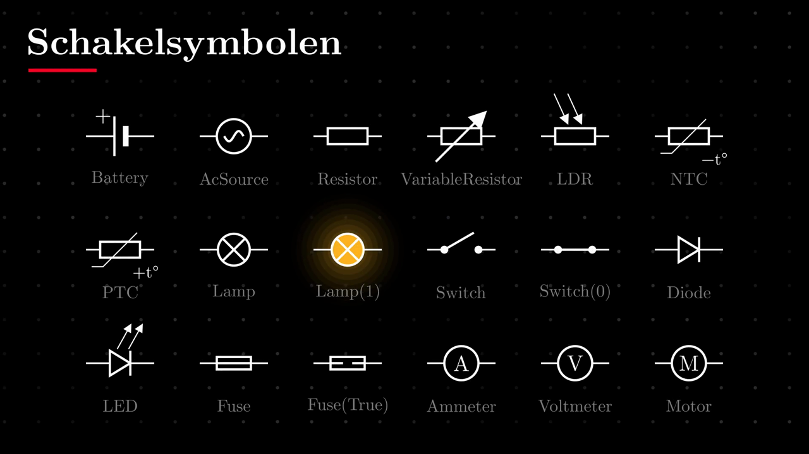

# nabla-design

De huisstijl van de natuurkundevideo's van **Nabla** als Python-pakket voor [manimgx](https://pypi.org/project/manimgx/):
kleuren, letters, lijndiktes, tijden, schakelsymbolen (Binas), animaties en de merkmomenten (intro, hoofdstukkaart,
formulekaart, eindscherm). Elke video importeert zijn stijl hieruit en zet een versie vast, zodat alle video's er
hetzelfde uitzien.



## Gebruiken in een video

`requirements.txt` van de video:

```
nabla-design @ git+https://github.com/nablanatuurkunde/Design-Language@v0.1.0
```

```python
from nabla import *


class Stroom(Lesson):
    def construct(self):
        self.set_camera_orientation(**CAM_TOP, zoom=1.0, frame_center=m.ORIGIN)
        lamp = Lamp(1).place([1, 0.6, 0], [1, -0.6, 0])
        d = say(self, "De lamp brandt.")
        self.do(d, *appear(lamp.glow(), lamp))
        self.end()
```

## Inhoud

```
nabla/
  style.py        merkkleuren, semantische kleuren, lettergroottes, lijndiktes, tijden, layout; text(), formula()
  circuits.py     schakelsymbolen als klassen (Resistor, Lamp, Switch, ...), Wire, Node, branch()
  animations.py   appear/vanish/draw/point_at/swap_value; stroompijltjes en elektronen
  scene.py        Lesson (basis van elke video), ondertitels, panelen, rekenbord
  branding.py     intro, hoofdstukkaart, formulekaart, eindscherm
custom_config.yml resolutie, fps, achtergrond, formule-preamble (Typst)
examples/StyleSheet.py   referentiescène met alles naast elkaar
docs/STYLEGUIDE.md       kleur → betekenis, groottes, wanneer welke animatie, wel en niet
docs/MIGRATION.md        het elektriciteit-project overzetten
```

## Ontwikkelen

```
pip install -e .
python -m manimgx render examples/StyleSheet.py -o videos/StyleSheet.mp4
```

Een stijlwijziging is een nieuwe release: verhoog `__version__` in `nabla/__init__.py`, commit, tag `vX.Y.Z`, en
zet daarna in de video de nieuwe tag vast. Vastgezet op **manimgx 0.1.1**.
