# Nabla styleguide

Zo zien Nabla-video's eruit. Alle waarden staan in [`nabla/style.py`](../nabla/style.py): in een scène gebruik je
alleen de namen, nooit een hexwaarde of een los getal voor kleur, grootte, lijndikte of tijd. De beelden komen uit
[`examples/StyleSheet.py`](../examples/StyleSheet.py).

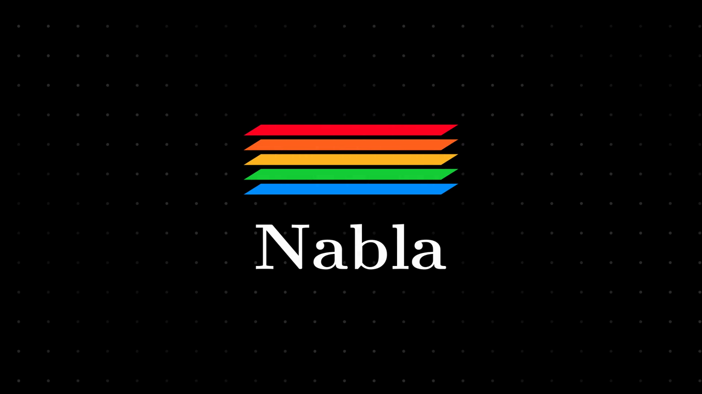

## Kleur = betekenis

Een grootheid heeft overal dezelfde kleur: in de schakeling, in de formule en in de grafiek. Al het andere is wit of
grijs op zwart.

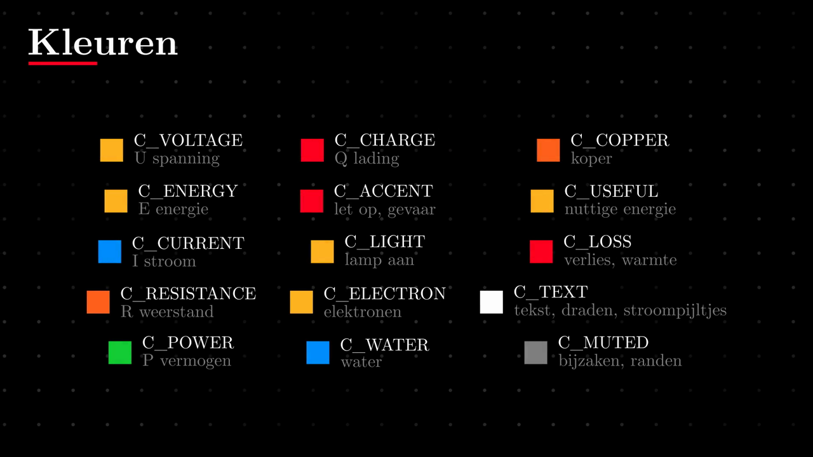

| Naam | Kleur | Betekenis |
|---|---|---|
| `C_VOLTAGE` | geel `#FFB31F` | U, spanning |
| `C_ENERGY` | geel `#FFB31F` | E, energie |
| `C_CURRENT` | blauw `#008EFE` | I, stroomsterkte (formule, meter, aanwijzen) |
| `C_RESISTANCE` | oranje `#FF601C` | R, weerstand |
| `C_POWER` | groen `#15CD36` | P, vermogen |
| `C_CHARGE` | rood `#FF0020` | Q, lading |
| `C_ACCENT` | rood `#FF0020` | let op: gevaar, kortsluiting, kapot, een kader dat aandacht vraagt |
| `C_CURRENT_ARROW` | wit | de bewegende stroompijltjes (+ → −) |
| `C_ELECTRON` | geel | elektronen (− → +) |
| `C_JOULE` | geel | lichtbolletjes uit een lamp, één per joule |
| `C_LIGHT` | geel | een brandende lamp |
| `C_WATER` | blauw | water in de waterkring (stroomt zoals de stroom) |
| `C_FIELD` | blauw | magnetisch veld |
| `C_COPPER`, `C_HOT` | oranje | koper; een gloeiend verwarmingselement |
| `C_USEFUL` | geel | nuttige / elektrische energie in energiebalken |
| `C_LOSS` | rood | energie die verloren gaat als warmte |
| `C_PROTON`, `C_NEUTRON` | rood, grijs | deeltjes in de kern |
| `C_TEXT`, `C_WIRE`, `C_EDGE` | wit | tekst, draden, randen van 3D-modellen |
| `C_MUTED`, `C_INSULATOR` | grijs `#808080` | bijzaken, paneelranden, isolatoren |
| `C_BG` | zwart | achtergrond |

`formula()` kleurt U, I, R, P, E en Q zelf. Geel en rood hebben elk meer dan één betekenis: laat de context (een
letter, een label, de plek in de kring) duidelijk maken welke bedoeld is.

### De vijf merkkleuren samen

`BRAND_STRIPES` (rood, oranje, geel, groen en blauw naast elkaar, zoals de strepen in het logo) is **alleen voor
merkmomenten**: de intro, hoofdstukkaarten en het eindscherm. Die staan allemaal in `nabla.branding`.
**Eén uitzondering:** `LED_COLORS` in de video over sensoren, omdat dat echte LED-kleuren zijn.

## Letters

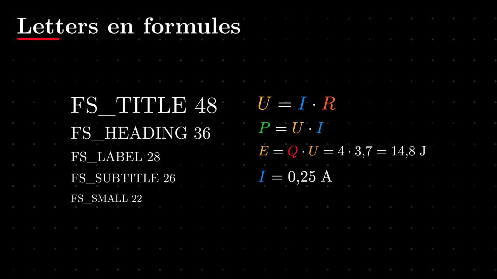

| Naam | Grootte | Waarvoor |
|---|---|---|
| `FS_TITLE` | 48 | titel van een onderdeel (`title()`), hoofdstuktitel |
| `FS_HEADING` | 36 | kop, grote vraag in beeld, meterstand |
| `FS_LABEL` | 28 | labels, panelen, de meeste tekst |
| `FS_SUBTITLE` | 26 | ondertitels |
| `FS_SMALL` | 22 | onderschriften, legenda's, `−t°` bij een NTC |
| `FS_FORMULA_KEY` | 52 | de kernformule van een onderdeel (`U = I · R`) |
| `FS_FORMULA` | 44 | een gewone formule |
| `FS_FORMULA_STEP` | 38 | een regel van een berekening |

Getallen krijgen een decimale komma: `value("U", 6, "V")` geeft *U = 6,0 V*. In zelfgeschreven formules gebruik je
`comma(r"3,0 = 0,5 \cdot 6")`. Schrijf **nooit** `{,}`: manimgx zet daar een spatie achter.

## Lijnen

| Naam | Dikte | Waarvoor |
|---|---|---|
| `SW_SYMBOL` | 4 | schakelsymbolen, maatlatten, een draad die nadruk krijgt |
| `SW_WIRE` | 3 | alle draden en de aansluitdraadjes van symbolen |
| `SW_FRAME` | 3 | kaders om tekst, omtrek van getekende voorwerpen |
| `SW_THIN` | 2 | paneelranden, randen van 3D-modellen, kleine instrumenten |
| `SW_HEAVY` | 6 | de streep onder een titel, het kruis bij een kapotte lamp, het ene stuk waar de scène naar wijst |

## Schakelsymbolen

IEC/NEN, zoals in Binas: een weerstand is een rechthoek, nooit een zigzag. Elk symbool is `SYMBOL_LENGTH` (1,2) lang,
aansluitdraadjes inbegrepen. Verkleinen mag alleen met `SYMBOL_SMALL` (0,7).

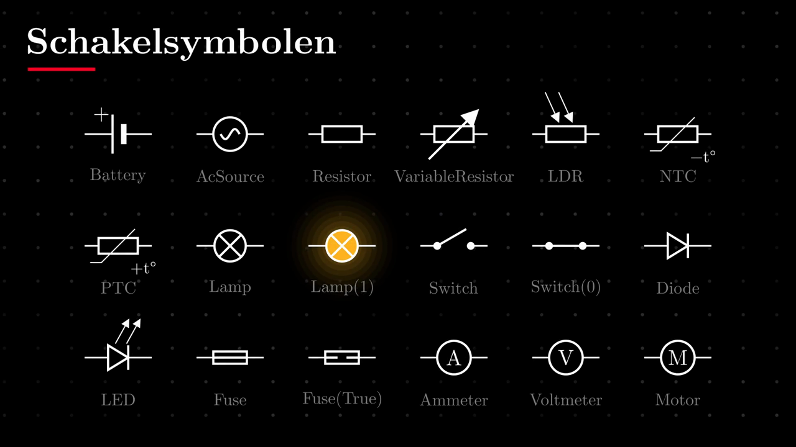

```python
r = Resistor().place(p, q)                 # midden tussen p en q, van p naar q
kring = VGroup(Wire(p0, r.a), r, Wire(r.b, q0))
kring = branch(p0, q0, Resistor())         # hetzelfde in één regel
lamp = Lamp(1); glow = lamp.glow()         # helderheid 0…1; de gloed teken je eronder
```

## Stroom en elektronen

Stroompijltjes zijn wit en lopen van + naar −; elektronen zijn geel en lopen andersom. Laat nooit pijltjes en
elektronen tegelijk zien. Er zijn twee manieren om stroomsterkte te tonen; kies per video één en houd die vast.

| Helper | Wat verandert met de stroom | Wanneer |
|---|---|---|
| `current_by_density(punten, I, I_max)` | hoe dicht de pijltjes op elkaar zitten (vaste snelheid `CURRENT_SPEED`, één pijltje per coulomb bij `I_max`) | standaard: stroom = lading per seconde. Splitsingen, serie en parallel, kortsluiting |
| `current_by_speed(punten, snelheid)` | hoe snel ze gaan (vaste afstand `ARROW_SPACING`) | als de video uitlegt met snelheid (wet van Ohm: dubbele spanning, dubbel zo snel) |
| `electron_flow(punten, snelheid)` | gele bolletjes, − → + | elektronen in de draad |

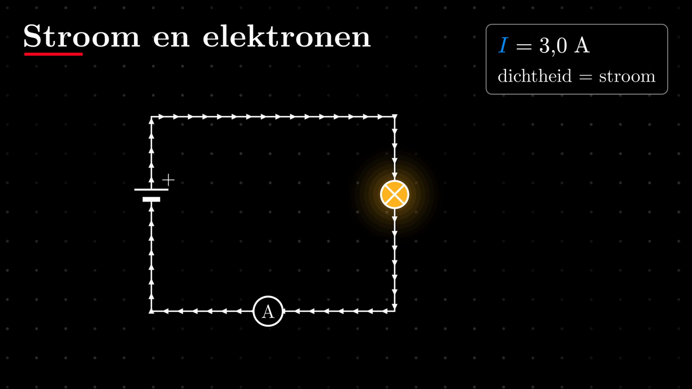
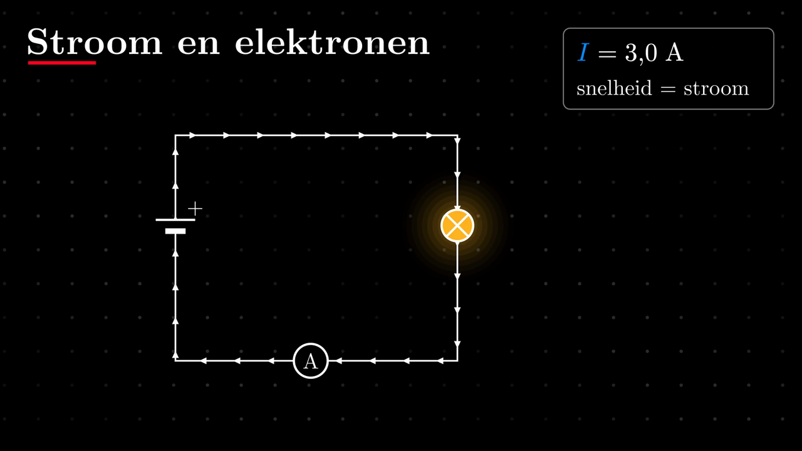
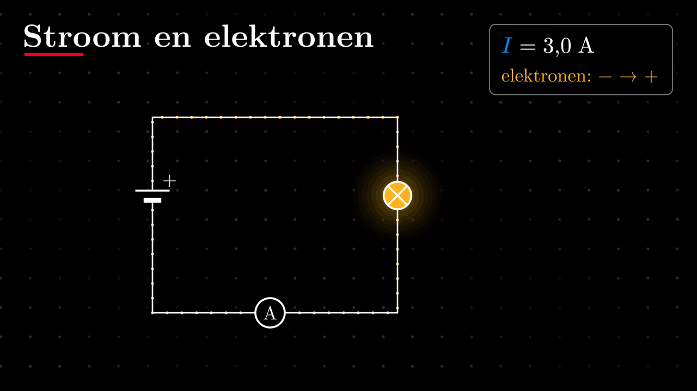

Pijltjes en elektronen liggen achter de symbolen. Een symbool met een gevuld lichaam (weerstand, lamp, meter, batterij)
verbergt ze vanzelf.

## In beeld komen en weer verdwijnen

| Wat | Hoe | Helper |
|---|---|---|
| panelen, labels, formules, symbolen | een gewone fade | `appear()`, `vanish()`, `self.show()` |
| draden, maatlatten, een kortsluitdraad | over hun lengte getekend | `draw()` |
| aandacht vestigen | kort oplichten in de kleur van de grootheid; `C_ACCENT` bij gevaar | `point_at(mob, C_VOLTAGE)` |
| een getal verandert | de nieuwe regel neemt de plek van de oude in | `swap_value(oud, nieuw)` |
| samenvatting | regels één voor één, het vlak met de eerste regel mee | `self.one_by_one()` |
| een langere berekening | wit rekenbord schuift van rechts in, de figuur schuift naar links | `self.board_in/board_swap/board_out` |
| synchroon met de tekst | animatie van `T_NORMAL`, daarna stilstaan tot de zin klaar is | `self.do(d, …)` |

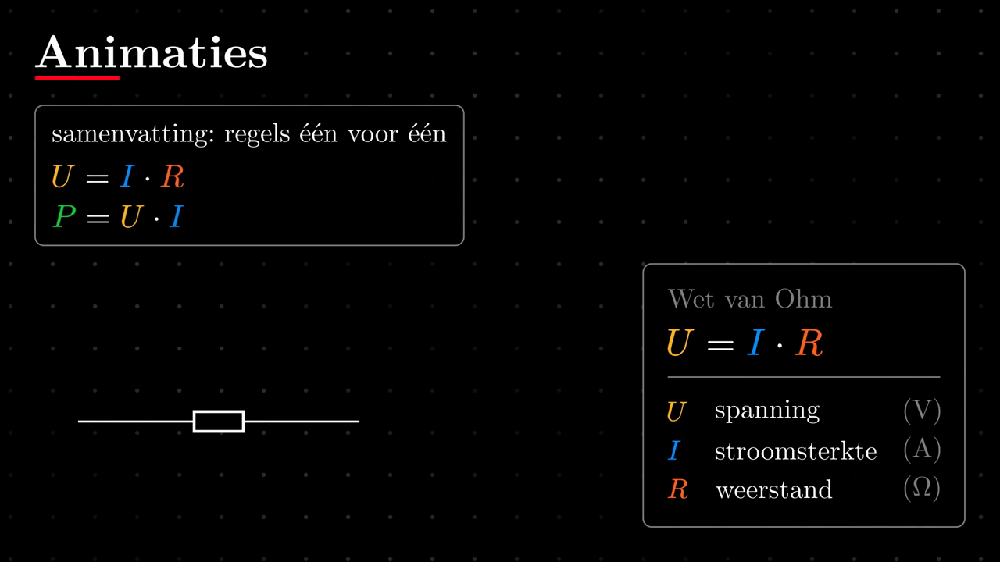
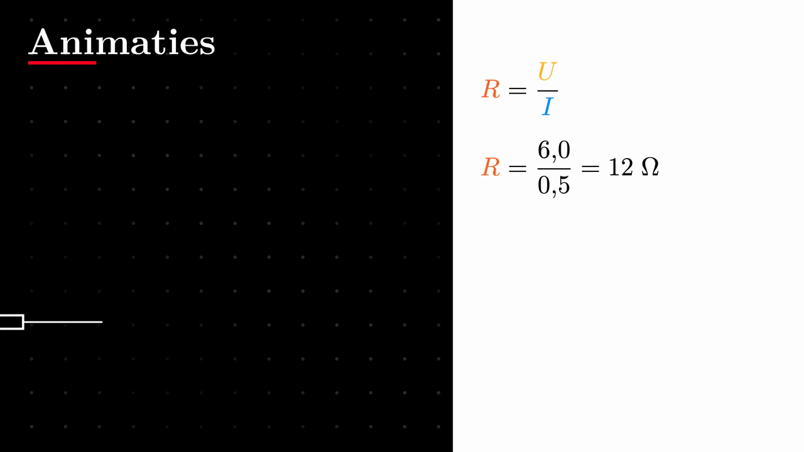

**Tijden:** `T_FAST` 0,5 s, `T_NORMAL` 1 s, `T_SLOW` 2 s, `T_CAMERA` 3 s (een camerawissel of het optillen van een
kring). Na een nieuwe stap `T_PAUSE` (1 s). Na "pauzeer de video": `self.think(d)` (+`T_THINK`, 2 s). Aan het eind:
`self.end()` (`T_END_HOLD`, 3 s). Gebruik de standaard `rate_func` (smooth). Gebruik `linear` alleen voor camerabanen,
tellers en iets dat gelijkmatig moet doorlopen.

## Indeling

Het beeld is 14,2 × 8. De titel staat linksboven (`title()`), met `MARGIN` (0,5) tot de rand. Panelen staan in een hoek
(`panel(…, corner=m.UR)`); een paneel onderaan schuift zelf boven de ondertitels. Staan schakeling en formules naast
elkaar, gebruik dan `ZONE_CIRCUIT` (links) en `ZONE_FORMULAS` (rechts). Het rekenbord begint op `BOARD_LEFT_X`.
Camerastanden: `CAM_TOP` (2D, recht van boven) en `CAM_TILTED` (3D, hoogte = spanning).

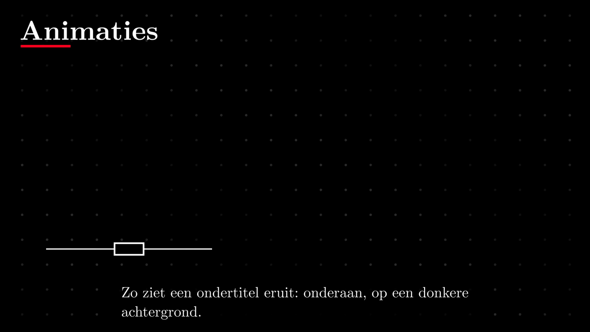

## Merkmomenten

| Moment | Helper |
|---|---|
| intro: de vijf strepen groeien in, daarna het woordmerk | `play_intro(self)` |
| hoofdstukkaart tussen twee delen | `play_chapter_card(self, 3, "Stroom")` |
| formulekaart in Binas-stijl: formule groot, daaronder symbool, betekenis en eenheid | `formula_card(tex, [("U", "spanning", "V"), …], "Wet van Ohm")` |
| eindscherm met ruimte voor de eindschermelementen van YouTube (`T_END_SCREEN`, 20 s) | `play_end_screen(self)` |

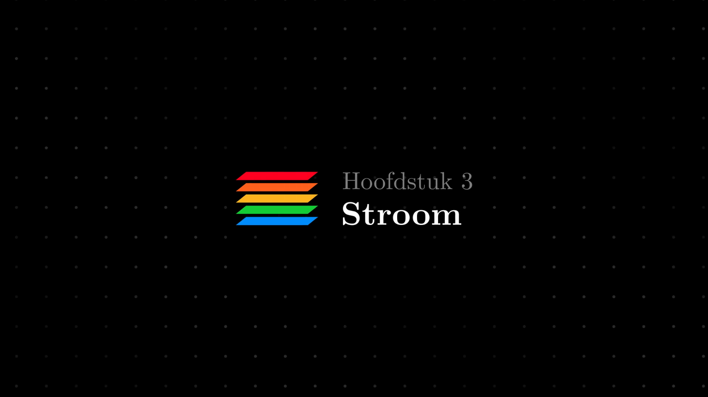
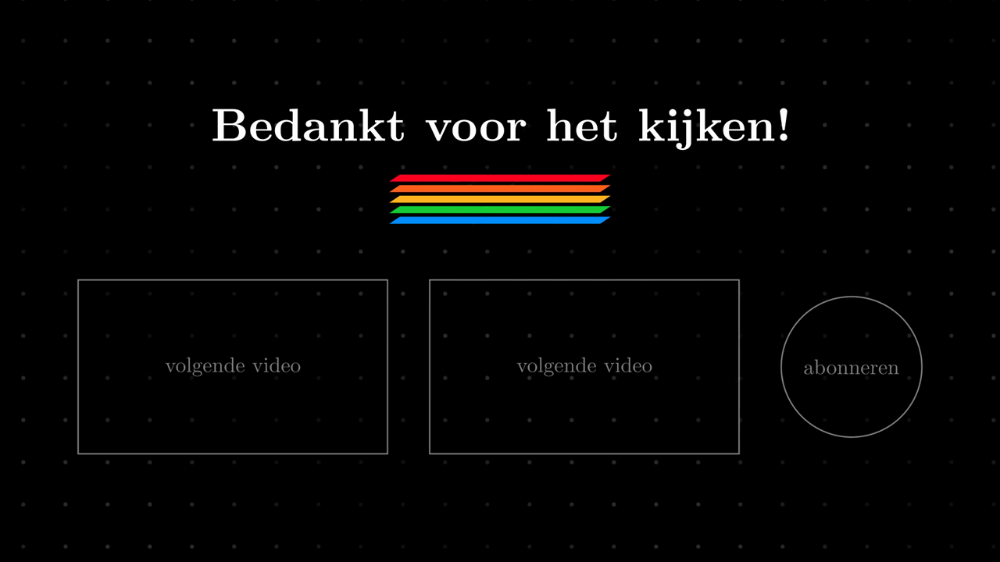

## Wel en niet

**Wel**
- Alleen semantische namen uit `nabla.style` gebruiken.
- Symbolen alleen uit `nabla.circuits`; draden met `.a` / `.b` op de aansluitpunten zetten.
- Per video één manier kiezen om stroom te tonen.
- Het beeld laten volgen wat de voice-over zegt.

**Niet**
- Hexwaarden, `m.BLUE` en dergelijke, of losse getallen voor `font_size`, `stroke_width` of `run_time`.
  Is iets bewust afwijkend (de klik van een knopje in 0,12 s), zet er dan een opmerking bij waarom.
- Een zigzagweerstand.
- De vijf merkkleuren samen buiten een merkmoment (behalve `LED_COLORS`).
- Pijltjes en elektronen tegelijk.
- `{,}` voor een decimale komma.
